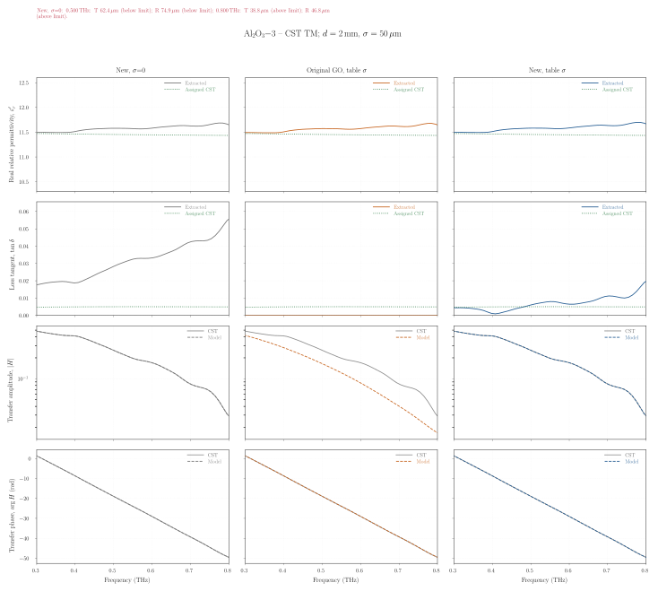

# THz-TDS Dielectric Parameter Extraction Algorithm


**Version: 0.2.1 — Initialisation Correction.**

This maintenance release addresses installation and initialisation failures reported on Windows.

**Version: 0.2.0 — RoE revision with the corrected surface-scattering model.**

> [!CAUTION]
> **Updated surface-scattering model.** This version corrects excess attenuation and reference-plane errors in the earlier formulation, with validation against CST simulations. For the current model derivation, see **Publication 1 (RoE, under review)** in [Citations & References](#-citations--references). Details are given in [Disclosure & Historical Note](#-disclosure--historical-note).

This software is an in-house developed algorithm at the University of Birmingham designed to extract complex dielectric parameters from **Terahertz Time-Domain Spectroscopy (THz-TDS)** measurements. It features a dual-stage workflow, advanced optimization routines, and a unique surface roughness-induced scattering compensation model based on Geometric Optics.

## 🚀 Key Features

- **Two-Stage Extraction:** Conversion from measured time-domain signals to frequency-domain parameter extraction.
- **Optimization:** Nelder-Mead simplex and least-squares optimization routines.
- **Surface Roughness Modeling:** Accounts for surface-scattering attenuation using Geometrical Optics, together with configurable Fabry–Pérot terms for internal reflections, subject to the applicable model assumptions.
- **Parallel Processing:** Serial and multiprocessing execution for parameter extraction.
- **Interactive Workflow:** GUI controls for preprocessing parameters and visual inspection before saving results.

## 📦 Installation & Setup

### 1. Download and open the repository folder

Download the repository as a ZIP using **Code → Download ZIP**, then extract it. Open the extracted folder that contains `install.py`, `pyproject.toml`, `config.yaml` and the `src` directory. In VS Code, use **File → Open Folder**, then **Terminal → New Terminal**. Keep the complete repository together.

### 2. Install Python 3.12

Use **Python 3.12**, including **Tcl/Tk and IDLE**, from [python.org](https://www.python.org/downloads/). Include the Python launcher when installing on Windows. On Linux, install Python 3.12 with its venv and Tkinter packages through your distribution's package manager.

### 3. Run the installer

**Windows PowerShell**

~~~powershell
py -3.12 install.py
~~~

**macOS and Linux**

~~~bash
python3.12 install.py
~~~

The installer creates the runtime in `.venv` and keeps Poetry 2.2.1 in `.venv-tools`. It runs from the repository directory, installs the committed runtime lock, checks dependency consistency and imports the required libraries.

### 4. Preprocess the time signals

Replace the example path below with your measurement root. Keep paths containing spaces inside quotes.

**Windows PowerShell**

~~~powershell
.\.venv\Scripts\python.exe src/tds_preprocessing_CLI.py --config config.yaml --root-dir "C:/Users/YourName/Documents/TDS measurements"
~~~

**macOS and Linux**

~~~bash
.venv/bin/python src/tds_preprocessing_CLI.py --config config.yaml --root-dir "/path/to/your/TDS measurements"
~~~

### 5. Extract the material parameters

After preprocessing finishes, run extraction with the same measurement root.

**Windows PowerShell**

~~~powershell
.\.venv\Scripts\python.exe src/tds_extraction_CLI.py --config config.yaml --root-dir "C:/Users/YourName/Documents/TDS measurements" --backend serial
~~~

**macOS and Linux**

~~~bash
.venv/bin/python src/tds_extraction_CLI.py --config config.yaml --root-dir "/path/to/your/TDS measurements" --backend serial
~~~

Replace `serial` with `multiprocessing` to use multiple CPU workers. The interactive workflow requires a graphical desktop. To check Tkinter independently, run `.\.venv\Scripts\python.exe -m tkinter` on Windows or `.venv/bin/python -m tkinter` on macOS/Linux.

The default `paths.root_dir` points to the included `folder_struct` example. Set `--root-dir` or edit `config.yaml` for your measurements. Preserve nested instrument and method directories.

### Troubleshooting

- **`Group(s) not found: main (via --only)`.** Run `install.py` from this release. It invokes Poetry 2.2.1 from its own environment and selects this repository explicitly. Check that the folder contains the supplied `pyproject.toml` and `poetry.lock`.
- **`[Errno 2] No such file or directory` when starting a CLI.** Check the filename named in the error. If it is `src/tds_preprocessing_CLI.py`, the terminal is outside the repository root or the archive was not fully extracted. Open the folder containing `src` and repeat the documented command. Replace example dataset paths with existing directories.
- **Python 3.12 cannot be found.** Install Python 3.12, reopen the terminal and repeat step 3.
- **Tkinter cannot be imported.** Repair Python with Tcl/Tk enabled. On Linux, install the Tkinter package for Python 3.12.
- **An old environment uses another Python version.** Rename that environment and rerun the installer.
- **No measurements are found.** Check the quoted dataset path, directory structure, metadata filename and column headers.
- **A download fails.** Check the connection and rerun the installer. Include the complete terminal error when reporting a problem.

## ⚙️ Data Structure Requirements

### 1) Directory Tree

With the default configuration, arrange measurements as follows:

```text
Root_Directory/
├── thickness.txt               # Sample metadata
└── Sample_Name/                # Must match a metadata 'material' entry
    └── Measurement_System/     # For example, Toptica_UoB
        └── pulse/              # Configurable through paths.pulse_dir_names
            ├── sample_data.txt # Time-domain sample/reference columns
            └── reference.txt   # Optional separate reference measurement
```

The signal columns and time unit are set by `file_handling.sample_column`, `file_handling.reference_column` and `file_handling.time_unit`. See [folder_struct](folder_struct) for example inputs.

### 2) Metadata File (`thickness.txt` or `thickness_info.txt`)

Create a **tab-separated** metadata file in the root directory. The default filename is `thickness.txt`; to use `thickness_info.txt`, set `paths.thickness_file` to that name in the configuration.

The default header must match `file_handling.required_cols`:

```text
material	thickness_mm	sigma_um	eps
```

Example with initial permittivity estimates:

```text
material	thickness_mm	sigma_um	eps
ROGERS_TMM3	3.1516	0.382325	3.27
ROGERS_RT6002	3.0707	0.613363	2.94
ROGERS_RT5880LZ	3.1334	0.586083	2.00
```

These permittivity values illustrate the file format; supply estimates appropriate to your samples, or leave those cells blank.

- `material`: sample folder name.
- `thickness_mm`: measured sample thickness in millimetres.
- `sigma_um`: RMS surface height in micrometres. Set it to **0** to disable the surface-roughness contribution.
- `eps`: optional initial estimate of real relative permittivity. **It may be left blank**, while retaining the column header; the preprocessing default is then `1.0`, unless overridden in the configuration. If your file uses `epsR`, change the fourth entry of `file_handling.required_cols` from `eps` to `epsR`.

See [folder_struct/thickness.txt](folder_struct/thickness.txt) for an example with blank permittivity cells.

## 🛠 Execution Modes

Run the commands in [Installation & Setup](#-installation--setup) from the repository root. The `.venv` interpreter works directly, without activation. Supply an existing measurement directory in quotes for `--root-dir`; the example path is a placeholder. Use `--help` with either script to inspect its options.

### Optional VS Code Launch Configuration

With the Python debugger extension installed, add this configuration to `.vscode/launch.json`. It uses the root directory from `config.yaml`; select the `.venv` interpreter in VS Code.

```json
{
  "version": "0.2.0",
  "configurations": [
    {
      "name": "THz TDS Processing",
      "type": "debugpy",
      "request": "launch",
      "program": "${workspaceFolder}/src/tds_preprocessing_CLI.py",
      "cwd": "${workspaceFolder}",
      "args": ["--config", "config.yaml"]
    },
    {
      "name": "THz TDS Extraction (Serial)",
      "type": "debugpy",
      "request": "launch",
      "program": "${workspaceFolder}/src/tds_extraction_CLI.py",
      "cwd": "${workspaceFolder}",
      "args": ["--config", "config.yaml", "--backend", "serial"]
    },
    {
      "name": "THz TDS Extraction (Multiprocessing)",
      "type": "debugpy",
      "request": "launch",
      "program": "${workspaceFolder}/src/tds_extraction_CLI.py",
      "cwd": "${workspaceFolder}",
      "args": ["--config", "config.yaml", "--backend", "multiprocessing"]
    }
  ]
}
```

## 📜 Disclosure & Historical Note

> [!CAUTION]
> **Model correction and CST validation**
>
> The updated formulation corrects excessive attenuation and errors associated with the definition of reference planes in the earlier surface-scattering model. These corrections have been checked against CST simulations.
>
> In the evaluated CST cases within the applicable Rayleigh surface-roughness limits, the revised model provides more reliable dielectric-parameter recovery than the conventional smooth-surface extraction, particularly for loss tangent. When surface-scattering attenuation is absent from the conventional model, fitting can incorrectly attribute it to intrinsic material absorption. This biases the extracted loss tangent; real permittivity is comparatively less affected in these evaluations.
>
> **Publication 1** below presents the current derivation, detailed validation, stress tests and uncertainty analysis. It is **Under Review** in the *Reviews of Electromagnetics*, EuCAP 2026 Special Issue.

This repository contains the latest, fully improved version of the THz extraction algorithm. To maintain academic and technical transparency:

- **Legacy Version:** The initial prototype of this software can be found at the [original prototype repository](https://github.com/Matthew-DBrown/THz-TDS-Material-Parameter-Extraction-Algorithm).
- **Evolution:** This implementation is a complete rewrite and improvement. While based on the same physical principles, the codebase has been fundamentally restructured.

### CST Validation Example: Al₂O₃ (TM)

The comparison below shows an Al₂O₃ slab under TM illumination, with a thickness of 2 mm and RMS roughness σₕ = 50 µm. The green dotted curves in the material-parameter panels represent the permittivity and loss tangent assigned in CST.

- **Left — conventional model (σₕ = 0):** Omitting surface-scattering attenuation causes the extraction to attribute that attenuation to intrinsic absorption, making the material appear substantially more lossy than specified in CST.
- **Centre — previous GO model (σₕ = 50 µm):** Excessive scattering attenuation in the earlier formulation drives the extracted loss tangent towards its near-zero lower bound, preventing recovery of the assigned intrinsic loss. The real-permittivity estimate still appears reasonable.
- **Right — corrected scattering-aware model (σₕ = 50 µm):** The revised formulation substantially improves recovery of the CST-assigned loss tangent while retaining a comparably accurate real-permittivity estimate. This example illustrates the improvement in recovering intrinsic material loss after correcting the scattering model.

<details>
<summary><strong>View the Al₂O₃ TM comparison (vector SVG)</strong></summary>

[](docs/figures/al2o3_cst_tm_model_comparison.svg)

[Open the full-size vector SVG](docs/figures/al2o3_cst_tm_model_comparison.svg).

</details>

## 📚 Citations & References

If you use this algorithm or its GO-based surface-scattering model, cite the relevant studies below. Use **Publication 1 for the current model derivation**.

> [!CAUTION]
> **Publication 1 — CURRENT MODEL DERIVATION · UNDER REVIEW**
>
> Alperen Sari, Yeganeh Farahi, Xen Sergi, Costas Constantinou and Miguel Navarro-Cía, “Validation and Uncertainties of a Geometrical Optics-Based Surface Scattering-Aware Dielectric Parameter Extraction Algorithm,” *Reviews of Electromagnetics*, EuCAP 2026 Special Issue, 2026. **Under Review.**

**Publication 2 — Published:** A. Sari et al., “Interlaboratory mmWave and THz Quasi-Optical Characterization of Commercial Conventional and 3-D Printable Substrates,” *IEEE Transactions on Terahertz Science and Technology*, vol. 16, no. 6, pp. 737–749, 2026. [DOI: 10.1109/TTHZ.2026.3674230](https://doi.org/10.1109/TTHZ.2026.3674230).

**Publication 3 — Published:** A. Sari, Y. Farahi, C. Constantinou and M. Navarro-Cía, “Uncertainty Analysis of a Surface Scattering-Aware Material Extraction Algorithm for THz-TDS Systems,” *2026 20th European Conference on Antennas and Propagation (EuCAP)*, Dublin, Ireland, 2026. [DOI: 10.23919/EuCAP68105.2026.11612344](https://doi.org/10.23919/EuCAP68105.2026.11612344).

**BibTeX:**

```bibtex
@article{sari2026roe,
  title   = {Validation and Uncertainties of a Geometrical Optics-Based Surface Scattering-Aware Dielectric Parameter Extraction Algorithm},
  author  = {Sari, Alperen and Farahi, Yeganeh and Sergi, Xen and Constantinou, Costas and Navarro-C{\'i}a, Miguel},
  journal = {Reviews of Electromagnetics},
  year    = {2026},
  note    = {Under Review; EuCAP 2026 Special Issue}
}

@article{sar2026thz,
  title   = {Interlaboratory {mmWave} and {THz} Quasi-Optical Characterization of Commercial Conventional and 3-D Printable Substrates},
  author  = {Sari, Alperen and others},
  journal = {IEEE Transactions on Terahertz Science and Technology},
  year    = {2026},
  volume  = {16},
  number  = {6},
  pages   = {737--749},
  doi     = {10.1109/TTHZ.2026.3674230}
}

@inproceedings{sari2026eucap,
  title     = {Uncertainty Analysis of a Surface Scattering-Aware Material Extraction Algorithm for {THz-TDS} Systems},
  author    = {Sari, Alperen and Farahi, Yeganeh and Constantinou, Costas and Navarro-C{\'i}a, Miguel},
  booktitle = {2026 20th European Conference on Antennas and Propagation (EuCAP)},
  address   = {Dublin, Ireland},
  year      = {2026},
  doi       = {10.23919/EuCAP68105.2026.11612344}
}
```

## 📂 Open Data & Reproducibility

The processed dataset obtained using this software suite, which supports the findings and characterization results presented in **[Sari et al., 2026]**, is publicly available.

You can access the full dataset via the link below:

👉 **Dataset Access:** [Open dataset](https://bham-my.sharepoint.com/personal/axs1927_student_bham_ac_uk/_layouts/15/guestaccess.aspx?share=IgDtw4CsmWmST4lbBxHRoLcLAUuLgpolsk_CvE-aKGRa0kM&e=K0natZ).

---

## 👤 Author

**Alperen Sari - PHDing at the University of Birmingham**

GitHub: [@alperensar](https://github.com/alperensar)

Email: [alperensari09@gmail.com](mailto:alperensari09@gmail.com)

Feedback, issue reports and suggestions are welcome. If you encounter a problem or have a recommendation for improving the software, please open a GitHub issue or contact the author by email.
